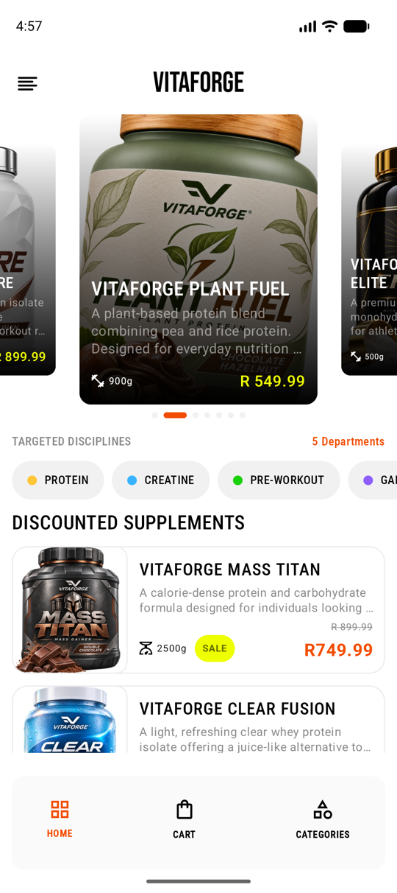
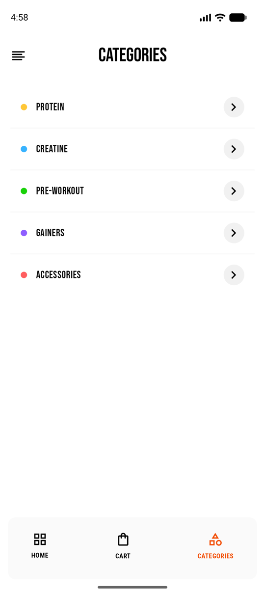
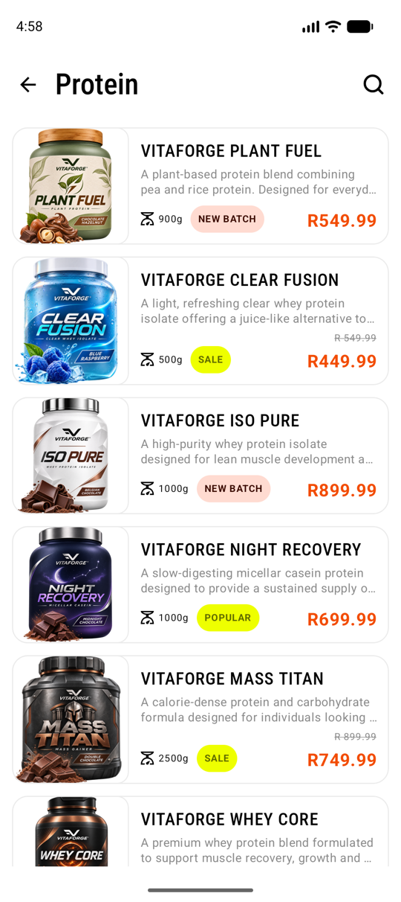
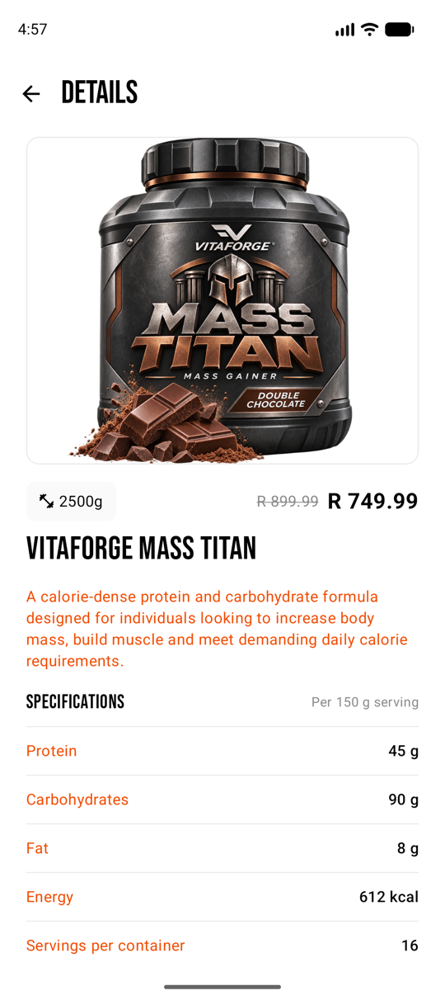
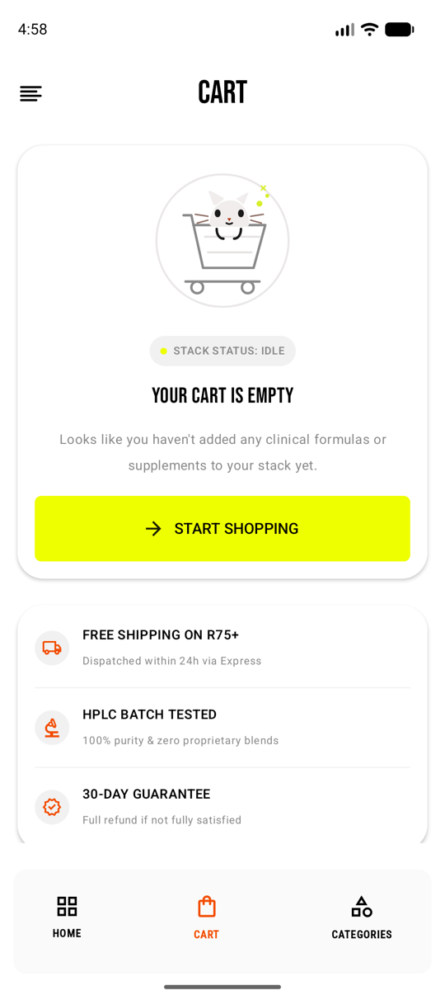
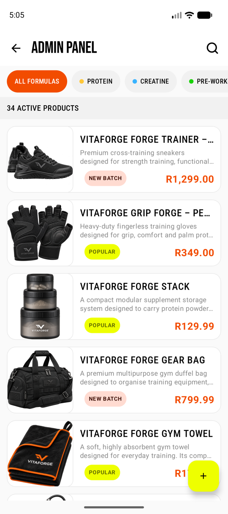
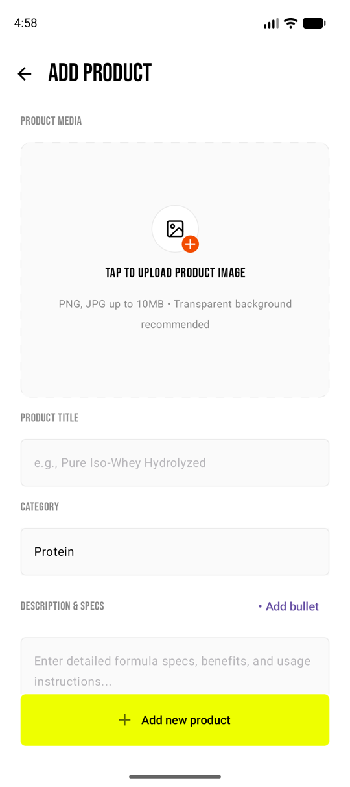

# VitaForge

A Kotlin Multiplatform e-commerce app for Android and iOS with a shared Compose Multiplatform UI. Customers browse supplements by category, add them to a cart, and check out with PayPal. Admins manage the product catalogue from inside the app.

## Screenshots

Captured on an Android emulator.

| Home | Categories | Category search | Product details |
|:---:|:---:|:---:|:---:|
|  |  |  |  |

| Empty cart | Admin panel | Add product |
|:---:|:---:|:---:|
|  |  |  |

## Features

- **Auth** — Google sign-in via Firebase Authentication (KMPAuth).
- **Browse** — a home screen with an auto-sliding new products carousel, category shortcuts, and discounted products; category browsing, and in-category search with loading, empty, and error states.
- **Product details** — description, specifications, and old and discounted prices. Pick from the available flavours, or colours and sizes for accessories, before adding to the cart.
- **Cart** — quantity controls (minimum of one), an item-count badge in the bottom bar, and inline error messages.
- **Checkout** — customer details form and a PayPal checkout flow that returns to the app through a deep link.
- **Orders** — an order is created in Firestore once payment completes, and the cart is cleared.
- **Order confirmation email** — a Cloud Function emails the customer when an order document is created (via [Resend](https://resend.com/)).
- **Profile** — view and manage the signed-in customer.
- **Admin panel** — list, filter, and search all products.
- **Product management** — create, edit, and delete products, with validation and delete/discard confirmations. Descriptions support bullet points, and products can have specifications. Manage flavours, colours, and sizes, with images per flavour or colour uploaded to Firebase Storage.
- **Push notifications** — set up with KMPNotifier.

## Architecture

Clean Architecture with MVVM and unidirectional data flow:

```
data  →  domain  ←  presentation
```

There is no separate `:domain` module. Domain models live in `:shared`, repository interfaces live in `:data`'s `domain` package, and use cases live in the feature that owns them.

- **`:shared`** — design system (colours, fonts, alpha tokens, Compose resources), domain models, and `Screen` routes.
- **`:data`** — repository interfaces plus `internal` implementations backed by Firebase (GitLive SDK). Repositories return `Result` and expose no SDK types.
- **`:di`** — Koin modules and `initialiseKoin()`. This is the only place implementations are wired to interfaces.
- **`:feature:*`** — one module per feature, each with its screens, ViewModels, use cases, and components. A ViewModel exposes a `StateFlow<UiState>` and delegates business logic to use cases.
- **`:navigation`** — the root `NavGraph` and platform entry points. Features receive navigation as lambdas, never a `NavController`.
- **`:androidApp` / `iosApp`** — thin platform hosts with no business logic.

### Dependency direction

```
androidApp / iosApp → navigation → feature:* → data, shared
                  └→ di → data, feature:*   (wiring only)
```

Feature modules never depend on other feature modules.

## Modules

```
VitaForge/
├── androidApp/                    # Android host
├── iosApp/                        # iOS host (Xcode project)
├── shared/                        # Design system, domain models, routes
├── data/                          # Repository interfaces + Firebase implementations
├── di/                            # Koin modules
├── navigation/                    # Root NavGraph, platform entry points
├── feature/
│   ├── auth/
│   ├── home/                      # Bottom-bar host
│   │   ├── products_overview/
│   │   ├── categories/
│   │   │   └── category_search/
│   │   └── cart/
│   │       └── checkout/
│   ├── details/
│   ├── payment_completed/
│   ├── profile/
│   └── admin_panel/
│       └── manage_product/
└── FIREBASE/                      # Firestore rules and Cloud Functions
```

## Tech stack

| Concern | Library |
|---|---|
| UI | Compose Multiplatform (Material 3) |
| DI | Koin |
| Backend | Firebase Auth, Firestore, Storage (GitLive Firebase KMP SDK) |
| Auth | KMPAuth (Google sign-in) |
| Networking | Ktor |
| Image loading | Coil 3 |
| Navigation | Navigation Compose (multiplatform) |
| Notifications | KMPNotifier |
| Async | Kotlin Coroutines + Flow |
| Serialization | kotlinx.serialization |
| Payments | PayPal REST API (sandbox) |
| Linting | ktlint |

Key versions: Kotlin 2.4.20, AGP 9.1.1, Compose Multiplatform 1.12.0, Koin 4.2.2, Ktor 3.6.0. See `gradle/libs.versions.toml` for the full catalogue.

## Getting started

### Prerequisites

- Android Studio (latest stable) with the Kotlin Multiplatform plugin
- Xcode, for the iOS app (macOS only)
- A Firebase project with Authentication (Google), Firestore, and Storage enabled
- A [PayPal developer](https://developer.paypal.com/) sandbox app
- Node 24 and the Firebase CLI, only if you want to deploy the Cloud Functions

### Setup

1. Clone the repo.
2. Add your Firebase config. These files are git-ignored:
   - `androidApp/google-services.json`
   - `iosApp/iosApp/GoogleService-Info.plist`
3. Add your PayPal sandbox credentials to `local.properties` (at the project root):

   ```properties
   paypal.clientId=YOUR_CLIENT_ID
   paypal.secretId=YOUR_SECRET
   ```

   The `generatePaypalCredentials` task in `shared/build.gradle.kts` reads these at build time and generates a `PaypalCredentials` object, so they are never committed.
4. Sync Gradle.

### Running

```bash
# Android
./gradlew :androidApp:assembleDebug
```

For iOS, open `iosApp/` in Xcode and run it from there. To check that the shared code compiles for iOS without Xcode:

```bash
./gradlew :shared:compileKotlinIosSimulatorArm64
```

## Firebase backend

The `FIREBASE/` directory holds the backend:

- **`firestore.rules`** — Firestore security rules.
- **`functions/`** — Cloud Functions (Node 24). `sendOrderConfirmationEmail` fires when a document is created in `order/{orderId}`, loads the line items from `product`, and sends a confirmation email through Resend.

To deploy the functions:

```bash
cd FIREBASE/functions
firebase functions:secrets:set RESEND_API_KEY
npm run deploy
```

Set `FROM_EMAIL` to an address on a domain you've verified in Resend. The default `onboarding@resend.dev` only delivers to your own Resend account email.

## Testing and code style

```bash
./gradlew allTests                           # all tests
./gradlew :shared:testAndroidHostTest        # Android host tests, per module
./gradlew :shared:iosSimulatorArm64Test      # iOS simulator tests, per module
./gradlew ktlintCheck                        # lint
./gradlew ktlintFormat                       # auto-format
```

## Conventions

Project rules live in [`CLAUDE.md`](./CLAUDE.md). In short:

- Default to `commonMain`. Platform source sets hold only glue code.
- Keep implementations `internal`, and keep SDK types out of domain signatures.
- All strings come from Compose Resources, and all colours and text styles come from `:shared` design tokens.
- Add dependencies only through the version catalogue.
- Secrets stay out of the repo.
